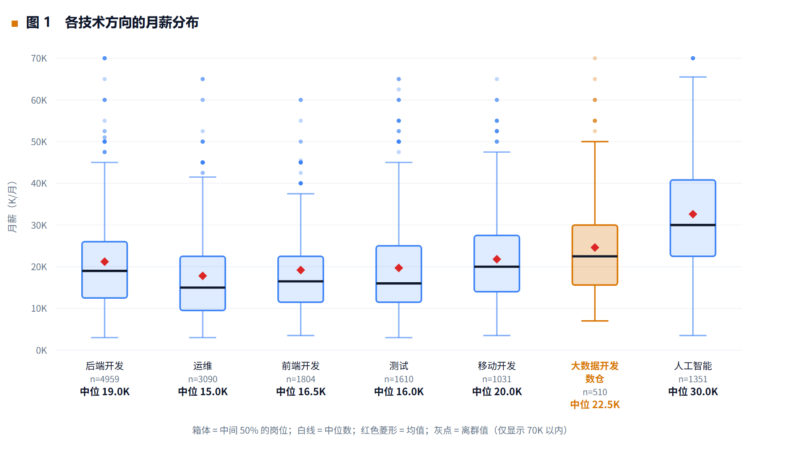
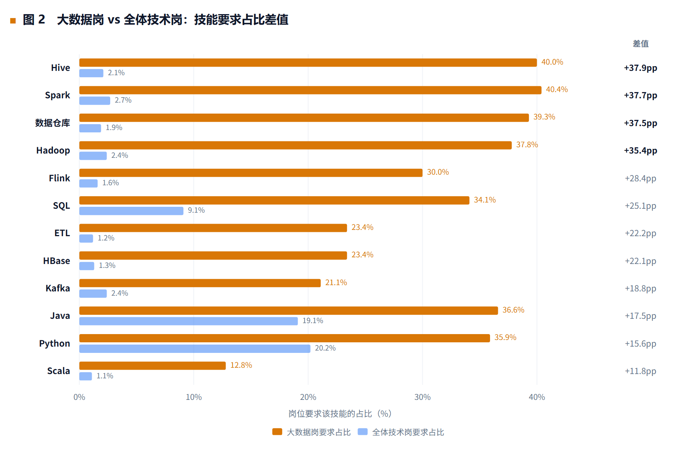
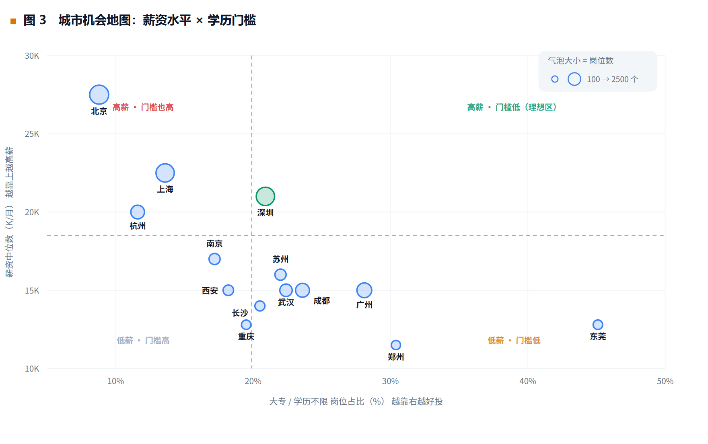
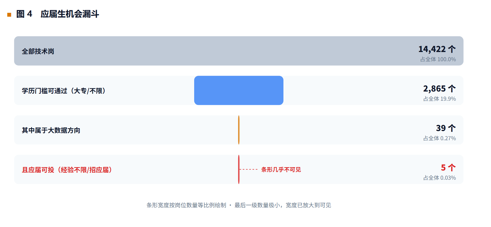

<div align="center">

# 大数据招聘岗位数据分析

**用 14,725 条真实招聘数据，算出一条能照着做的求职路径**

[📊 在线作品集](https://your-username.github.io/bigdata-job-analysis/) · [📄 完整项目报告](REPORT.md) · [📖 网页版报告](report.html) · [🎤 面试口述稿](docs/面试口述稿.md) · [❓ 面试问答清单](docs/面试问答清单.md)


</div>

---

## 这是什么

一个**面向求职决策**的数据分析项目，不是"练手玩数据"。

招聘信息本身就是一份大样本、可量化、由企业用真实薪资预算投票产生的需求数据——每一行岗位描述，都是企业在说"我愿意为具备这些能力的人付这个价钱"。所以我拿它来回答一个自己正面临的问题：

> 作为一名大数据技术专业的**专科应届生**，我应该优先补齐哪些技能、投递哪些岗位方向、选择哪些城市？

项目的价值不在图表，而在它输出的**投递策略**。结论直接改变了我的求职计划：原本准备毕业就投"大数据开发工程师"，现在改为先投数据运维、ETL、后端开发等技能相邻岗位，积累 1–2 年真实数据项目经验后再转岗。

---

## 四条结论

### 结论一：方向值得选，但不要把它当成第一份工作

大数据岗薪资中位数 **22.5 K**，高于后端开发的 19.0 K、运维的 15.0 K。
但 577 个大数据岗里，"大专学历 + 应届可投"的只剩 **5 个**，严格口径（只算明确写"在校/应届"）是 **0 个**。

👉 投递清单从"大数据开发工程师"换成：**数据运维/ETL**（884 个专科可投岗）、**后端开发**（861 个）、**测试开发**（349 个）——技能栈与数据开发高度重叠，两年后带着真实数据处理经验转岗。

### 结论二：技能按"组合"学，不要按"清单"堆

关键指标不是"哪个技能出现得多"，而是**大数据岗与全体技术岗的差值**：

| 技能 | 大数据岗 | 全体技术岗 | 差值 |
| :--- | ---: | ---: | ---: |
| Hive | 40.0% | 2.1% | **+37.9 pp** |
| Spark | 40.4% | 2.7% | **+37.7 pp** |
| 数据仓库 | 39.3% | 1.9% | **+37.5 pp** |
| Hadoop | 37.8% | 2.4% | **+35.4 pp** |
| Linux | 15.8% | 15.9% | **−0.1 pp** |

前四者是入场券；Linux 差值几乎为零——**它不是加分项，是及格线**。

👉 学习顺序按"命中率 × 区分度"排：SQL → Hive → Spark → Hadoop → Kafka → Flink。目标是能跑通一条 **Hive 建仓 → Spark 计算 → 结果落库** 的完整链路（Hive + Spark 同时出现于 30.2% 的岗位）。

### 结论三：城市优先级为广州 ≈ 成都 > 武汉 > 北京

| 城市 | 薪资中位数 | 大专可投占比 | 大数据岗数 |
| :--- | ---: | ---: | ---: |
| 北京 | 27.5 K | 8.8% | 145 |
| 广州 | 15.0 K | **28.1%** | 40 |
| 成都 | 15.0 K | 23.6% | 31 |
| 武汉 | 15.0 K | 22.4% | 18 |

北京薪资最高，但大专可投比例最低——**高薪是用学历门槛换来的**。

### 结论四：别用"我会 Spark"去谈薪

全样本看，要求 Spark 的岗位薪资高 **+6.5 K（+35.1%）**；
把城市等级固定在一线/新一线、经验固定在 1–5 年、只在大数据岗内部比较后，差值变成 **−2.5 K（−11.1%）**。

那 35% 的溢价来自**岗位方向本身**，不是技能稀缺性。在数据开发岗里 Spark 是标配。

👉 简历上不要写技能名词，要写能力和结果："用 Spark 处理过 X 亿条日志，把报表产出时间从 4 小时压到 2 分钟"。

---

## 四张图

<table>
<tr>
<td width="50%"><br><b>图 1 · 箱线图</b><br>X = 岗位方向（按中位数排序）／Y = 月薪（K/月）<br><sub>选方向：哪个方向值得进</sub></td>
<td width="50%"><br><b>图 2 · 横向分组条形图</b><br>X = 岗位要求该技能的占比／Y = 技能（按差值排序）<br><sub>学什么：哪些是专属门槛</sub></td>
</tr>
<tr>
<td width="50%"><br><b>图 3 · 气泡散点图</b><br>X = 大专可投占比／Y = 薪资中位数／面积 = 岗位数<br><sub>去哪座城市：薪资与门槛的权衡</sub></td>
<td width="50%"><br><b>图 4 · 漏斗图</b><br>每一级为条件叠加后的剩余岗位数<br><sub>现实：三重条件下还剩多少机会</sub></td>
</tr>
</table>

> 每张图在[报告第 4 章](REPORT.md#4-探索性数据分析)都写了**图表类型 / 坐标轴 / 读图要点 / 面试追问预演**。

---

## 数据与方法

| 项 | 说明 |
| :--- | :--- |
| 数据来源 | 和鲸社区公开的拉勾招聘数据集（原始采集自 lagou.com 公开职位列表） |
| 数据规模 | 原始 21,320 条 × 21 列 → 清洗后 **14,725 条 × 59 列** |
| 覆盖范围 | 70 类岗位 / 179 座城市 / 6,700 家企业 / 2022.08–2024.01 |
| 技术栈 | Python 3 · pandas · NumPy · re · matplotlib · 原生 SVG |
| 代码量 | 约 1,100 行，4 个独立模块 |

### 技术链路

```
数据获取 → 数据清洗 → EDA 探索分析 → 可视化 → 结论输出
          (8 步)      (4 层 / 20 张表)   (4 张图)   (4 条结论)
```

### 三个关键技术判断

**1. 先检验数据本身，再分析数据**

统计各类别记录数后发现：70 个岗位类别中有 23 个（33%）记录数 ≥ 400，且集中砸在 440–450 一线；而现实中 Java 的岗位量是 Perl 的几十倍，在这份数据里两者却几乎一样多。

→ 判定为**按类别封顶采样**（每类最多采集约 450 条）。因此全文所有占比结论一律表述为"**样本内占比**"，不做市场需求规模排名。这一步是整个项目最容易被忽略、也最容易被面试官挑出的地方。

**2. 相关结论必须做一次分层验证**

Spark 溢价从 +35.1% 反转到 −11.1%，靠的不是换个说法，而是把城市、工龄、岗位方向三个混淆变量固定住再比一次。**能反驳自己的结论，结论才有价值。**

**3. 删数据之前先证明该删**

按 `positionId` 去重删掉了 6,580 行（占原始 30.9%），比例高得反常。验证了两条：3,568 个重复组中跨城市重复为 **0 组**、组内薪资 **100% 相同** → 确认为重复采集而非真实需求，删除合理。

### 清洗质量校验

| 检验 | 方法 | 结果 |
| :--- | :--- | :--- |
| 异常值敏感性 | 剔除异常 vs 加回异常，两套口径对比 | 中位数完全一致（18.5 K / 22.5 K），均值仅变 0.03 K |
| 城市排名稳定性 | 两套口径重算 Top8 | 排名顺序完全一致 |
| 样本结构检验 | 统计各类别记录数分布 | 识别出封顶采样偏差，已限定结论适用范围 |

> 第一项是回答"你删异常值会不会影响结果"的标准答法——**做两套口径跑一遍，用数据说话**，而不是口头保证"影响不大"。

---

## 仓库结构

```
bigdata-job-analysis/
├── README.md                  仓库首页（本文件）
├── REPORT.md                  📄 完整项目报告（6 章 / 17 张表 / 4 张图）
├── report.html                📖 网页版报告（由 REPORT.md 生成，GitHub Pages 可读）
├── index.html                 📊 在线作品集（原生 SVG 图表，GitHub Pages 首页）
├── images/                    报告与 README 引用的图表 PNG
│   ├── fig1_salary_box.png
│   ├── fig2_skill_gap.png
│   ├── fig3_city_bubble.png
│   └── fig4_funnel.png
├── src/                       分析代码
│   ├── 01_data_cleaning.py    8 步清洗流程
│   ├── 02_eda_analysis.py     4 层 / 20 张分析表
│   ├── 03_charts_data.py      计算图表精确坐标
│   ├── 03_visualization.py    matplotlib 出图
│   ├── make_charts.py         图表导出为 PNG
│   └── build_report_html.py   REPORT.md → report.html
├── docs/                      面试准备与部署材料
│   ├── 面试口述稿.md          🎤 2 分钟项目讲述稿（含 30 秒版）
│   ├── 面试问答清单.md        ❓ 34 个高频提问 + 参考回答
│   └── 发布到GitHub-Pages.md   🚀 部署步骤与常见问题
└── data/
    └── README.md              数据获取说明（仓库不托管原始数据）
```

---

## 快速开始

```bash
git clone https://github.com/your-username/bigdata-job-analysis.git
cd bigdata-job-analysis

pip install pandas numpy matplotlib

# 数据需自行从和鲸社区下载后放入 data/，详见 data/README.md
python src/01_data_cleaning.py
python src/02_eda_analysis.py
python src/03_charts_data.py
python src/03_visualization.py
```

---

## 已知局限

如实列出，因为**知道结论在什么条件下不成立，比结论本身更重要**：

| # | 局限 | 对结论的影响 |
| :---: | :--- | :--- |
| 1 | **按类别封顶采样**（33% 类别记录数集中在 440–450） | 所有"某类岗位占比"结论不成立，全文仅表述为样本内占比 |
| 2 | 单一平台来源（仅拉勾网），偏互联网/科技行业 | 结论限定为"互联网及科技行业招聘市场" |
| 3 | 时间窗口 2022.08–2024.01 | 2024 年后的技术趋势（湖仓一体、AI 辅助开发）未覆盖 |
| 4 | 薪资为挂牌值而非实发值 | 只做横向比较，不做绝对收入预测 |
| 5 | 技能靠关键词匹配抽取 | 语义等价表述会漏检，导致**低估**而非高估，不影响相对排序 |
| 6 | 未覆盖软技能与项目经验要求 | 明确列为不在分析范围内 |
| 7 | 小样本交叉单元格 | 单元格样本量不足 10 条时置空，不做结论 |
| 8 | 薪资区间按上下限均值计算 | 统一口径保证组间可比，与真实 offer 有偏差 |

**后续可优化方向**：补采多平台数据做交叉验证 → 用 TF-IDF 发现新兴技能词 → 把经验要求做成生存分析 → 做成可交互的查询工具。

---

## 关于我

专科 · 大数据技术专业 · 2024 届

正在找**数据开发 / 数据分析 / 数据运维**方向的工作。

如果这个项目有打动你，欢迎联系：`your-email@example.com`

---

<div align="center">
<sub>数据来源：和鲸社区公开数据集，仅用于学习与研究。图表与代码采用 MIT License。</sub>
</div>
